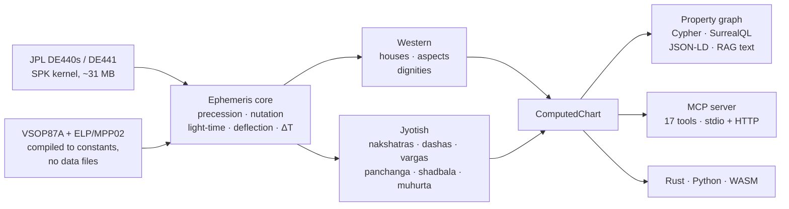

# Vedaksha — Vision from Vedas

**Clean-room Rust ephemeris and Vedic astrology engine, built for the agentic-AI era.** Sub-arcsecond planetary precision, every algorithm traced to a primary source, any chart queryable as a property graph.

[](https://crates.io/crates/vedaksha)
[](https://docs.rs/vedaksha)
[](https://pypi.org/project/vedaksha/)
[](https://www.npmjs.com/package/vedaksha-wasm)
[](https://github.com/arthiqlabs/vedaksha/actions/workflows/ci.yml)
[](Cargo.toml)
[](LICENSE)

[Website](https://vedaksha.net) · [Docs](https://vedaksha.net/docs) · [Playground](https://vedaksha.net/playground) · [API reference](https://docs.rs/vedaksha) · [Blog](https://vedaksha.net/blog)

`clean-room` · `0.096″ mean longitude vs JPL Horizons` · `1,603 tests (per push) + 24,350 oracle rows` · `MCP-native` · `BUSL-1.1 → Apache 2.0`

[Install](#install) · [Quick start](#quick-start) · [Accuracy](#accuracy) · [What's inside](#whats-inside) · [MCP + property graph](#mcp--property-graph) · [Provenance](#clean-room-provenance) · [License](#license)

---

## Install

| Platform | Install | Notes |
|----------|---------|-------|
| Rust | `cargo add vedaksha` | full pipeline |
| Python | `pip install vedaksha` | engine via WebAssembly, `py3-none-any`, Python ≥ 3.9 — no Rust toolchain |
| WASM | `npm install vedaksha-wasm` | browser & edge, no data files |
| MCP | `cargo install vedaksha-mcp` | stdio + HTTP (bearer auth) |
| Docker | `docker run -e VEDAKSHA_MCP_TOKEN=… -p 3100:3100 ghcr.io/arthiqlabs/vedaksha-mcp` | multi-arch (amd64 + arm64) |

Compute **janam kundali** (natal charts), **panchanga**, **dashas**, **nakshatras**, **vargas**, **shadbala**, **ashtakavarga**, **muhurta** and **transits/gochara** from a sub-arcsecond ephemeris (JPL DE440s/DE441, worst case 0.272″ against Horizons) or from the data-file-free VSOP87A + ELP/MPP02 series (mean 0.160″, worst case 1.473″ over 1900–2025).



## Quick start

```python
from vedaksha import Vedaksha

vk = Vedaksha()
chart = vk.natal_chart(julian_day=2451545.0, latitude=28.6139, longitude=77.2090)
```

```bash
cargo install vedaksha-mcp && vedaksha-mcp     # stdio: Claude Desktop, Cursor, VS Code
```

The Rust path is a compiled doctest in [`crates/vedaksha/src/lib.rs`](crates/vedaksha/src/lib.rs).

**Every Julian Day on the public surfaces is UT1**, not TT and not TDB. The engine converts to TT internally for the dynamical terms and uses UT1 for Earth rotation, which fixes the ascendant, MC and all twelve cusps. Passing a TDB Julian Day adds ΔT worth of rotation instead of removing it — 0.289° (17.3′) at today's ΔT ≈ 69 s, on every cusp. The one exception is the raw SPK query (`state_vector`), which indexes the kernel directly and takes TDB.

## Accuracy

These figures are reproducible, not just asserted: [`vedaksha-parity`](https://github.com/arthiqlabs/vedaksha-parity)
is a separate harness (maintained by the same authors as this engine) that anyone can run against
their own copies of the reference kernels to check the published numbers below.

Every figure is printed by a named test. Reproduce the ephemeris tables with `bash scripts/download_de440s.sh`, then `cargo test -p vedaksha-ephem-core --release -- --include-ignored --nocapture`; the ayanamsha figures come from `cargo test -p vedaksha-astro sidereal`, and the cross-check against an independent Python derivation of the same primaries from `cargo test -p vedaksha-astro --test ayanamsha_fixture`.

**What the headline 0.096″ measures — precisely.** It is a mean *apparent geocentric ecliptic-longitude* residual, not a general position-accuracy figure: the fixture also carries `ref_latitude`, `ref_distance` and `ref_speed`, but `oracle_comparison.rs` marks them `dead_code` and none of the three enters this number. It covers the 1900–2025 rows, at 1,535 comparisons per body (15,350 total across 10 bodies). The full 1900–2100 grid of 24,350 rows has a mean of 0.088″ and the same worst row (see below); the 1900–2025 cut is kept so that the published count and definition do not change. And it compares against **planetary-system barycentres**, not physical planet centres, matching what the DE440s kernel stores and what `SpkReader` returns; querying centres instead would inject a spurious ~0.1″ offset for the outer planets (`scripts/generate_horizons_oracle.py`) — the same order of magnitude as the headline mean itself. These facts are also published as data in `metrics.json`'s `accuracy` block (`quantity`, `era`, `targetConvention`), so the site renders them rather than anyone hand-copying this paragraph.

**SpkReader vs JPL Horizons (DE441)** — `oracle_comparison.rs`, 24,350 committed rows (10 bodies × 2,435 dates, 1900–2100). Horizons serves DE441, so this measures our DE440s pipeline against an independent kernel.

| Era | Comparisons | Mean | Max |
|-----|-------------|------|-----|
| 1900–2025 | 15,350 | **0.096″** | 0.272″ (Moon, 1962-01-06) |
| 1900–2100 (all) | 24,350 | 0.088″ | 0.272″ (Moon, 1962-01-06) |

All 24,350 comparisons are within one arcsecond. Per body over 1900–2025 the mean runs from 0.092″ (Moon) to 0.100″ (Pluto), and the worst row of every body is between 0.243″ and 0.272″.

**Time scale.** Horizons' time tags are UT1 before 1962-01-20 and UTC from then. The oracle converts the UTC tags to TT with the leap-second count, as Horizons does itself, and reads the engine in TT, so neither ΔT nor UT1 − UTC is part of those rows' residual, and the oracle says nothing about ΔT there; earlier rows go through the engine's ΔT. Rows from 2026 on are compared the same way and are within 0.189″ (Moon, 2099-10-04). A Julian Day in UT1 after 2033.75 rests on an extrapolated ΔT (`delta_t.rs`), and one second of ΔT moves the Moon about 0.55″.

**What the remaining 0.096″ is.** After 1962 every body sits at 0.047″ to 0.054″ mean and at most 0.062″; before 1962 the bodies sit at 0.138″ to 0.146″ mean. That offset is shared by every body: it is the difference between Horizons' IAU 1976/1980 precession and nutation and the IAU 2006/2000B this engine uses. It is a difference of convention, and it is not emulated here. The largest row, the Moon on 1962-01-06, lies between 1962-01-01, where this engine hands ΔT from the SMH2016 spline to the USNO rows, and 1962-01-20, where Horizons switches from its pre-1962 series to its Earth-orientation file; the two series differ by 0.371 s across that handover, which is 0.2″ of Moon longitude (`delta_t.rs`). The Sun's light deflection of the planets is applied; until it was, the worst row was 1.187″ (Uranus, 0.36° from the Sun).

**AnalyticalProvider vs JPL Horizons** — `analytical_oracle.rs`, 1900–2025: overall mean **0.160″**, worst case **1.473″** (Neptune, 2025-09-02), Moon 0.094″ mean via ELP/MPP02 (0.055″ after 1962). 13,815 comparisons across 9 bodies (1,535 dates per body) over 1900–2025; see `metrics.json`'s `accuracy.analytical` block. The same run over all 21,915 comparisons to 2100 has a mean of 0.251″ and a worst case of 2.248″ (Neptune, 2078-01-27); `metrics.json` does not publish that pair.

Per body, because the mean hides a pattern worth knowing before you pick this provider:

| body | mean″ | body | mean″ |
|---|---|---|---|
| Sun | 0.094 | **Jupiter** | **0.148** |
| Moon | 0.094 | **Saturn** | **0.159** |
| Mercury | 0.094 | **Uranus** | **0.257** |
| Venus | 0.094 | **Neptune** | **0.410** |
| Mars | 0.090 | | |

The Sun, the Moon and the inner planets sit in a tight band at 0.090″ to 0.094″ and the error then grows outward. Split at 1962-01-20, all nine bodies sit at 0.131″ to 0.153″ mean before it, the same frame offset the SPK path shows. After it the Sun and the inner planets are at 0.038″ to 0.039″, the Moon at 0.055″, and Jupiter, Saturn, Uranus and Neptune at 0.165″, 0.165″, 0.365″ and 0.660″.

That growth belongs to the theory, not to how the tables are cut. `scripts/generate_vsop87a.py` drops terms below a uniform absolute amplitude of 1e-7 AU, but evaluating the complete untruncated VSOP87A series gives the same outer-planet residuals as the committed tables to four decimals (measured on geometric heliocentric vectors against DE440s over 1900–2100; the notes on `VSOP87A_TO_EQUATORIAL` in `crates/vedaksha-ephem-core/src/analytical/mod.rs` have the table). The authors fitted the theory to the JPL integration DE200, not to DE440 (`vsop87.doc`, "PRECISION"), and that is what the residual measures. **If you need the outer planets to sub-0.1″, use `SpkReader`**, where they are no worse than the inner bodies: Jupiter and Saturn are 0.096″ mean against the same oracle, inside the 0.092″ to 0.100″ band of every other body.

Until 2026-08-20 those figures were 2.06″ mean and 24.22″ worst, and this README attributed the gap to VSOP87A being a truncated theory. That was wrong, and the wording protected a defect of ours: the analytical provider answered `EarthMoonBarycenter` with VSOP87A's Earth-centre series, so the observer sat 4,671 km off, and `earth_state` divided a barycentre-relative Moon by `1 + EMRAT` instead of `EMRAT` for a further 56.8 km. Both are fixed. The second one moved the SPK path too, 0.106″ → 0.103″.

At v10.0.0 the SPK mean goes from 0.103″ to 0.096″ and its worst row from 1.187″ to 0.272″; the analytical mean from 0.239″ to 0.160″ and its worst row from 1.896″ to 1.473″; the analytical Moon from 0.169″ to 0.094″. One body is worse at its maximum: analytical Uranus, 1.111″ to 1.201″. The causes are in [`CHANGELOG-v10.0.0.md`](CHANGELOG-v10.0.0.md): ΔT read from the measurements and the published predictions, 30 corrected nutation rows, the Sun's light deflection of the planets, VSOP87A rotated by the matrix its authors publish, and an oracle that compares Horizons' UTC tags in TT.

**ELP/MPP02 Moon** — `lunar_horizons.rs`: **0.015″ at J2000**, 0.020–0.053″ across 1500–2500 CE.

### What is *not* measured

- **House cusps are not validated against any external reference.**
- **No ayanamsha is validated against another implementation, and that is deliberate.** All eleven are derived forward from a primary — a chapter, a committee, a proposer's own paper, or a star catalogue — and each reproduces its own anchor to 1e-9° and, where its primary documents one, its own zero year. What is *not* claimed is agreement with anyone else's numbers: comparing against them would be the reverse-engineering this re-derivation exists to undo. See [`docs/audit/2026-08-17-ayanamsha-cleanroom/`](docs/audit/2026-08-17-ayanamsha-cleanroom/).
- **Dasha, nakshatra and shadbala tests check the text's own rules**, not an external comparison: they verify that BPHS constants sum to 120 years, that boundaries tile the circle, and that shadbala parts come out as the verses' formulas give them when worked by hand. No dasha period or shadbala figure is compared with another implementation's output.
- **The library's coarse shadbala form is partial.** `compute_shadbala_full` carries four of Sthana Bala's five parts (Uchcha, Ojhayugma, Kendradi and Drekkana, without Saptavargaja) and only Nathonnata and Paksha of Kala Bala, as 0-or-30 steps; its Cheshta, Dig and Drik grades are not the verses'. The complete form, `compute_shadbala_complete` (BPHS 27, part by part, with an option wherever the text leaves a parameter open), is what the MCP `compute_shadbala` tool and the WASM export serve.

## Technical report

A full write-up of both ephemeris pipelines, their measured accuracy, and the clean-room
provenance of every algorithm: [`docs/paper/main.tex`](docs/paper/main.tex) (build with
`make -C docs/paper pdf`, requires `tectonic`).

It goes well beyond the summary above, and reports several things that are stated nowhere else:

- **Independent cross-validation by a third party** against two national-agency ephemerides from
  two different agencies (JPL DE440 and IMCCE INPOP21a), rather than agreement with JPL alone.
- **Analytical-path accuracy across 1550–2650 CE**, per body and per century-band of distance
  from J2000, with the time scale removed from the comparison by addressing both sides in TT so
  that ΔT divergence cannot contaminate the residual.
- **Component-level validation of the SPK reader** against another implementation's read of a
  comparable kernel, isolating the DAF/SPK parser and Chebyshev evaluation from the
  apparent-place pipeline layered on top.
- **A methodological note on reproducibility**: bit-level output is architecture-scoped, because
  the SIMD trigonometric kernel maps to one AVX2 register but two NEON registers. Accuracy is
  not — measured identical to a milliarcsecond on both. (Since v10.0.0 the lunar series alone no longer calls
  that kernel and is bit-identical on both architectures; the whole analytical provider still is not.)
- **What is not validated, stated plainly**, including house cusps, the true node, and every
  ayanamsha.

**Status: not peer reviewed, and not submitted anywhere.** It is a technical report, not a
preprint. Every measured figure in it is specific to the engine version named on its title page.

## What's inside

**Two ephemeris providers.** `SpkReader` reads JPL DE440s (~31 MB) for sub-arcsecond work. `AnalyticalProvider` compiles VSOP87A + ELP/MPP02 to constants and needs no data files — for WASM, edge and Cloudflare Workers. `ChebyshevProvider` is an opt-in provider that fits the same series per segment with Chebyshev polynomials (within 0.1 m for the Moon and 3 m for a planet, over the whole range) for workloads that ask for many nearby times; `AnalyticalProvider` stays the exact series.

**Jyotish, from primary sources.** 27 nakshatras with padas and lords · 8 dasha systems (Vimshottari, Ashtottari and Yogini, which runs beyond its first round; the rashi dashas Chara, Narayana, Sthira, Niryana Shoola and Maheshwara) · all 16 vargas (D-1 → D-60) · the complete shadbala of BPHS 27 with Ishta/Kashta phala, bhava bala (27.26 to 31) and vimshopaka bala (all four schemes) · 11 ayanamshas, each traceable to a chapter, a star or a committee · panchanga's five limbs, with vara reckoned from local sunrise and Rahu/Gulika Kalam as real time windows · graded and degree-wise (sputa) drishti per BPHS Ch. 26 · four upagrahas (Kala, Mrityu, Ardhaprahara, Yamaghantaka) · mean, true and osculating nodes, all referred to the ecliptic of date, with the J2000 variant tracking DE441's `OM` to 0.6″ (KP sub-lord ready).

**Sky events, in the `vedaksha-vedic` crate.** Solar and lunar eclipses, every sign ingress and retrograde station of a graha in a range, heliacal rising and setting by the Surya Siddhanta's kalamsha, amanta and purnimanta lunar months with adhika and kshaya, and tithi, nakshatra, karana and yoga ends and sankrantis timed to the resolution of a Julian Day. Long scans read the Moon and the Sun from an interpolated walk (`walk::BodyWalk`, `vedaksha_vedic::walked::WalkedSky`) within 5e-5″ for the Moon and 1e-5″ for the Sun of the direct computation; the planets are not walked.

**Western: calculation, not interpretation.** 10 house systems, major aspects with applying/separating motion, essential dignities, synastry and composite. `ChartConfig` defaults to tropical. There is no Western interpretive layer and no parity with the Jyotish surface.

**Crates**, published to crates.io in lockstep: [`vedaksha`](crates/vedaksha) (umbrella, 7 locales) · [`-math`](crates/vedaksha-math) · [`-ephem-core`](crates/vedaksha-ephem-core) · [`-astro`](crates/vedaksha-astro) · [`-vedic`](crates/vedaksha-vedic) · [`-graph`](crates/vedaksha-graph) · [`-mcp`](crates/vedaksha-mcp).

## MCP + property graph

17 tools, discoverable with a single `tools/list`. The catalog is generated from the Rust definitions and locked by a snapshot test, so it cannot silently drift from the code. `compute_dasha` serves the eight dasha systems above. `compute_shadbala` takes a moment and a place (`julian_day`, `latitude`, `longitude` and a sidereal `ayanamsha`), casts the chart itself and returns every part of BPHS 27 for the seven grahas.

`compute_natal_chart` · `compute_dasha` · `compute_vargas` · `compute_karakas` · `compute_combustion` · `compute_shadbala` · `compute_ashtakavarga` · `compute_transit` · `compute_gochara` · `search_transits` · `search_muhurta` · `compute_panchanga` · `compute_drishti` · `compute_bhavas` · `compute_synastry` · `compute_composite` · `emit_graph`

Any chart converts to a property graph via `emit_graph` or `vedaksha_graph::chart_to_graph`, emitting Cypher, SurrealQL, JSON-LD, JSON or RAG embedding text. An agent can then ask "which planets aspect the 7th-house lord?" as a graph query instead of re-implementing chart logic. Computations themselves return typed structs; the graph is a projection you ask for.

**What a chart actually yields:** 4 of the ontology's 9 node types (`Chart`, `Planet`, `Sign`, `House`) and 7 of its 12 edge types. `Nakshatra`, `Pada`, `Pattern`, `DashaPeriod` and `FixedStar` are defined in `vedaksha_graph::ontology` but are not built from a `ComputedChart`, which does not carry the data they need. Compute those through their own APIs.

```bash
VEDAKSHA_MCP_TOKEN=… vedaksha-mcp --http --port 3100
```

HTTP mode requires `Authorization: Bearer <token>` on every POST and refuses to start without `VEDAKSHA_MCP_TOKEN`, unless you pass `--insecure-no-auth` for a trusted network. `/health` and the informational `GET` stay open.

## Clean-room provenance

Every implemented algorithm carries a `// Source:` doc-comment naming its primary paper or treatise — VSOP87A, ELP/MPP02, IAU standards, BPHS, Jaimini. Two subsystems have been re-derived from primary sources behind a documented firewall, and each ships its own audit directory: the lunar theory ([2026-05-09](docs/audit/2026-05-09-elp-mpp02-cleanroom/)) and the sidereal surface ([2026-08-17](docs/audit/2026-08-17-ayanamsha-cleanroom/)). Each records the primaries, the process, what was searched and rejected, and a generator that re-derives the values so the claim can be re-run rather than taken on trust. See also [`DATA_PROVENANCE.md`](DATA_PROVENANCE.md). This is the evidence a BUSL-1.1 licensee can audit.

## In production

| Product | What it is |
|---------|------------|
| [kundalimcp.com](https://kundalimcp.com) | Agentic-AI Jyotish MCP with the full computation suite. Builds directly on the `vedaksha-*` crates. |
| [kundali.live](https://kundali.live) | Consumer endpoint — chat-based readings and self-serve PDF reports. |

## License

**Business Source License 1.1** — SPDX `BUSL-1.1`, which is what crates.io, PyPI and npm display.

- **Non-commercial** — free (personal, research, education, internal tools).
- **Commercial** — $500, charged once per organization. Unlimited products and seats, perpetual, and it covers the version you license and every version released after it — not charged again per release. [Purchase →](https://vedaksha.net/pricing)
- **Converts to Apache 2.0** four years after each version's release. That future licence
  text is kept at [`CHANGE-LICENSE.txt`](CHANGE-LICENSE.txt) — it is the *Change License* in
  BUSL terms, **not** a licence you may choose today.

See [LICENSE](LICENSE), [SECURITY.md](SECURITY.md), [CONTRIBUTING.md](CONTRIBUTING.md) and [MAINTENANCE.md](MAINTENANCE.md).

---

Copyright © 2026 ArthIQ Labs LLC · Licensed under the Business Source License 1.1 (`BUSL-1.1`).
